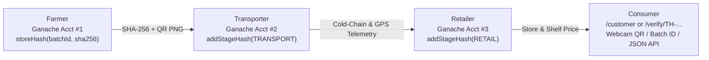
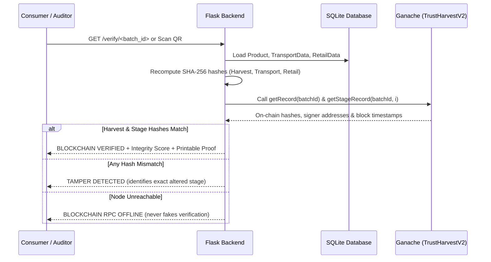

# TrustHarvest: Decentralized Agricultural Supply Chain & Food Provenance Platform

TrustHarvest is an end-to-end decentralized agricultural supply chain tracking and food provenance platform. It combines a **Flask** web application with an **Ethereum smart contract** (via **Web3.py** and **Ganache**) to deliver tamper-evident tracking from farm to consumer.

Each agricultural batch is cryptographically hashed at harvest, anchored immutably onto the Ethereum blockchain, assigned a unique batch ID and dynamic QR code, and tracked across transport, retail, and consumer verification stages.

---

## Technology Stack

* **Backend Framework:** Python 3.11+, Flask 3.x, Werkzeug
* **Persistence & ORM:** Flask-SQLAlchemy 3.x / SQLAlchemy 2.0 (SQLite default, PostgreSQL compatible)
* **Smart Contracts & Blockchain:**
  * Solidity `^0.8.19` ([`contracts/TrustHarvestV2.sol`](contracts/TrustHarvestV2.sol) — multi-stage provenance active by default)
  * Web3.py `6.15+` for JSON-RPC communication & contract event log indexing
  * Ganache (Ethereum local node running at `http://127.0.0.1:7545`, Chain ID `1337`)
  * `py-solc-x` for automated compilation & historical-to-V2 migration
* **Security & Form Handling:** Flask-WTF (CSRF protection), scrypt password hashing, session hardening (`HttpOnly`, `SameSite`, configurable `Secure`), login rate limiting
* **Frontend:** Jinja2 templates, Bootstrap 5, Bootstrap Icons, Chart.js 4, `html5-qrcode@2.3.8` (live webcam & QR image file scanner), `@media print` certificate styling
* **QR & Imaging:** `qrcode[pil]`, Pillow (PIL)

---

## Main Features

1. **Multi-Stage Immutable Provenance (`TrustHarvestV2.sol`):** Anchors harvest batch attributes one-time via `storeHash(batchId, hash)` AND records append-only custody checkpoints (`TRANSPORT`, `RETAIL`) via `addStageHash(batchId, stage, dataHash)` signed by dedicated stakeholder Ganache accounts.
2. **Cryptographic Transaction Receipts & Signer Attribution:** Persists and displays `tx_hash`, `block_number`, `contract_address`, and stakeholder `signer_address` (`accounts[1]` Farmer, `accounts[2]` Transporter, `accounts[3]` Retailer) across dashboards and public verification pages.
3. **Webcam, Image-Upload & 1-Click Demo QR Scanner (`/customer`):** Consumers can verify via Batch ID lookup, live webcam QR scan (`Html5Qrcode`), QR PNG image upload, or a 1-click **"Demo Decode QR"** button for camera-free live presentations.
4. **Cold-Chain Telemetry & Provenance Integrity Score (0–100):** Parses cold-chain temperature sensors (`Optimal` -2 to 8 °C, `Cool/Ambient` 8 to 15 °C, `Cold-Chain Breach` >15 °C or <-2 °C) and computes an objective Integrity Score from live cryptographic checks + telemetry.
5. **Interactive Harvest & Cold-Chain Tamper Simulator:** One-click simulation buttons on `/verify/<batch_id>` demonstrate SHA-256 avalanche mismatch detection for both origin metadata and cold-chain logistics checkpoints.
6. **Live Admin EVM Explorer & Integrity Audit (`/admin`):** Displays real-time Ganache signer wallet balances, live smart contract events (`HashStored`, `StageAnchored`), and per-batch live DB-vs-Chain verification status.
7. **Public JSON Verification API & Printable Certificates:** Machine-readable REST endpoints (`/api/health`, `/api/verify/<batch_id>`) plus a print-clean certificate stylesheet.
8. **Honest Fault-Tolerant Blockchain Layer:** Cleanly separates `BLOCKCHAIN VERIFIED`, `TAMPER DETECTED`, `LEDGER CONFLICT`, `UNRECORDED ON CHAIN`, and `BLOCKCHAIN RPC OFFLINE`.

---

## Supply Chain Workflow





### 1. Farmer / Producer
* Logs in and accesses the **Farmer Dashboard** or the **Multi-Stage Workflow**.
* Enters crop name, quantity, farming method (e.g., Organic), packaging date, and farm origin.
* Uploads product photo (validated for mime type, extension, and file size).
* The platform:
  * Generates a unique batch identifier (`TH-XXXXXXXX`).
  * Computes a canonical SHA-256 hash across immutable attributes.
  * Sends an Ethereum transaction invoking `storeHash(batchId, hash)` on the smart contract.
  * Generates a branded QR code linked to `/verify/<batch_id>`.

### 2. Transporter / Logistics
* Receives produce from the farm.
* Records transit checkpoints: current location, storage temperature (e.g., cold chain at 4.0 °C), vehicle number, and shipment inspection notes.
* Updates batch status to *In Transit*.

### 3. Retailer / Supermarket
* Receives shipment at the store or distribution center.
* Records retail arrival date, retail price per unit, remaining shelf life, and stock quantity.
* Updates batch status to *In Stock* or *Available for Sale*.

### 4. Consumer / Public Verifier
* Scans the QR code on the physical package or enters the Batch ID on `/verify/<batch_id>`.
* The system recalculates the SHA-256 hash from database attributes and queries the smart contract via `getHash(batchId)`.
* **Verification States:**
  * **Verified Authentic (Green):** On-chain hash matches computed database hash.
  * **Tampered (Red):** Database record has been modified after on-chain anchoring.
  * **RPC Offline (Yellow):** Ganache node is not reachable; displays cached database hash with offline notice.
  * **Not Found:** Batch ID does not exist on-chain.

---

## Project Structure

```
blockchain/
├── contracts/
│   ├── TrustHarvest.sol          # Legacy V1 contract (historical compatibility)
│   └── TrustHarvestV2.sol        # Active V2 multi-stage Solidity 0.8.19 contract
├── static/
│   ├── css/style.css             # Agricultural green identity, tabs & @media print styles
│   ├── img/                      # Static branding and role imagery
│   ├── qr/                       # Generated batch QR codes (.gitkeep preserved)
│   └── uploads/                  # Uploaded produce images (default.jpg fallback)
├── templates/
│   ├── base.html                 # Navigation, persona switcher & blockchain pill
│   ├── landing.html              # Public landing page with timeline preview
│   ├── login.html                # Secure authentication form
│   ├── register.html             # User registration form
│   ├── farmer.html               # Farmer produce management & QR download
│   ├── transporter.html          # Cold-chain logistics tracking & telemetry badges
│   ├── retailer.html             # Supermarket inventory & V2 on-chain receipts
│   ├── customer.html             # Tabbed consumer lookup + webcam/file/demo QR scanner
│   ├── admin.html                # Executive KPIs, signer wallets, EVM event log & charts
│   ├── verify.html               # Multi-stage verification, Trust Score & printable certificate
│   ├── workflow.html             # Multi-stage supply chain stepper
│   └── workflow_stepper.html     # Reusable workflow progress bar partial
├── tests/
│   ├── conftest.py               # Isolated test SQLite fixtures
│   ├── test_auth.py              # Authentication & password hashing tests
│   ├── test_blockchain_hashing.py# Hash computation & honest offline checks
│   ├── test_contract_proposal.py # TrustHarvestV2 Solidity compilation tests
│   ├── test_role_switcher.py     # Role authorization & persona switcher tests
│   ├── test_security_uploads.py  # File upload validation & CSRF tests
│   ├── test_v2_and_api.py        # Multi-stage V2, telemetry, API & live Ganache tests
│   └── test_workflow.py          # Complete multi-stage workflow tests
├── app.py                        # Core Flask application & routing
├── blockchain.py                 # Web3.py wrapper, compilation & deployment logic
├── config.example.json           # Sample template for contract ABI, bytecode & address
├── models.py                     # SQLAlchemy database models (User, Product, Stages)
├── pytest.ini                    # Pytest configuration
├── requirements.txt              # Production and development dependencies
├── seed.py                       # Demo data population utility
├── utils.py                      # QR generation, hashing & file validation helpers
├── .env.example                  # Environment configuration template
├── .gitignore                    # Comprehensive exclusion rules
└── README.md                     # Project documentation
```

---

## Installation & Setup Instructions

### Prerequisites
* **Python:** 3.11 or higher
* **Ganache:** Ganache GUI (v2.7.1+) or Ganache CLI (`npm install -g ganache`)
* **Git**

### Step 1: Clone the Repository
```bash
git clone https://github.com/DakshDhaundiyal/blockchain.git
cd blockchain
```

### Step 2: Create and Activate Virtual Environment
* **Windows (PowerShell):**
  ```powershell
  python -m venv venv
  .\venv\Scripts\Activate.ps1
  ```
* **Linux / macOS:**
  ```bash
  python3 -m venv venv
  source venv/bin/activate
  ```

### Step 3: Install Dependencies
```bash
pip install -r requirements.txt
```

### Step 4: Configure Environment Variables
Copy `.env.example` to `.env`:
* **Windows (PowerShell):**
  ```powershell
  Copy-Item .env.example .env
  ```
* **Linux / macOS:**
  ```bash
  cp .env.example .env
  ```
*Open `.env` and configure your settings:*
```ini
SECRET_KEY=your-custom-secret-key-for-development
FLASK_ENV=development
DATABASE_URL=sqlite:///trustharvest.db
GANACHE_URL=http://127.0.0.1:7545
BASE_URL=http://localhost:5000
MAX_CONTENT_LENGTH=5242880
```

### Step 5: Configure Blockchain Settings
Copy `config.example.json` to `config.json`:
* **Windows (PowerShell):**
  ```powershell
  Copy-Item config.example.json config.json
  ```
* **Linux / macOS:**
  ```bash
  cp config.example.json config.json
  ```
*(Note: `config.json` is ignored by Git to keep your local contract addresses and network state private.)*

---

## Running Ganache and Deploying the Smart Contract

1. **Start Ganache:**
   * Open the **Ganache GUI** and click **Quickstart (Ethereum)**.
   * Or run Ganache CLI v7+:
     ```bash
     npx ganache -p 7545 -h 127.0.0.1 --chain.chainId 1337 --chain.networkId 1337
     ```
   * Ensure the RPC server is listening at `http://127.0.0.1:7545`.

2. **Automatic Contract Deployment:**
   * TrustHarvest automatically manages V2 deployment and backwards compatibility. When a batch or transaction is initiated, `blockchain.py` checks bytecode and V2 ABI support (`getStageCount`) at `config.json`'s active address.
   * Any prior V1 contract address is preserved in `historical_contract_addresses`, while `contracts/TrustHarvestV2.sol` is compiled (`solc 0.8.19`), deployed using Ganache Account 0, and recorded into `config.json`.

---

## Running the Application

1. **Seed Demo Accounts and Multi-Stage Batches:**
   ```bash
   python seed.py
   ```
   *Seeded Demo Accounts:*
   * **Farmer (`farmer_john`):** `farmer123` (Ganache Signer Account #1)
   * **Transporter (`transporter_dan`):** `transit123` (Ganache Signer Account #2)
   * **Retailer (`retailer_sarah`):** `retail123` (Ganache Signer Account #3)
   * **Customer (`customer_amy`):** `customer123`
   * **Admin (`admin`):** `admin123` (Ganache Signer Account #0)

2. **Start the Flask Development Server:**
   ```bash
   python app.py
   ```

3. **Access & Demonstrate the Application:**
   * Open **`http://localhost:5000`** in your browser.
   * Use the **Role Switcher** in the navbar for passwordless live demo switching between Farmer, Transporter, Retailer, Customer, and Admin.
   * **Showcasing QR Verification Without a Physical Label:**
     1. Visit `/customer` and open the **Camera / Image QR Scanner** tab.
     2. Click **Demo Decode QR** to fetch and run `Html5Qrcode` across a real generated batch QR PNG, **or** click **Download QR PNG** on any batch and upload the image file.
     3. Optionally click **Start Webcam** to scan a batch QR code shown on a phone or secondary screen.

---

## How Multi-Stage Verification Works

### 1. Canonical Hash Calculation
At Harvest (`compute_batch_hash`), Transport (`compute_transport_hash`), and Retail (`compute_retail_hash`), database fields are normalized into sorted-key JSON and hashed with SHA-256.

### 2. On-Chain Smart Contract Anchoring (`TrustHarvestV2`)
```solidity
function storeHash(string memory batchId, string memory hash) public;
function addStageHash(string memory batchId, string memory stage, string memory dataHash) public;
```
* **Immutability Protection:** `storeHash` reverts with `AlreadyRegistered(batchId)` if called twice for the same batch ID; `addStageHash` records append-only `TRANSPORT` and `RETAIL` hashes signed by dedicated stakeholder wallets.

### 3. Public Verification, API & Tamper Detection
* **Web Certificate (`/verify/<batch_id>`):** Recomputes harvest, transport, and retail hashes against `getRecord` and `getStageRecord`, displays transaction receipts and cold-chain status badges (`-2 °C .. 8 °C` Optimal, `8 .. 15 °C` Cool/Ambient, `> 15 °C` Breach), and includes **Simulate Harvest Tamper** / **Simulate Cold-Chain Tamper** demo toggles + **Print Certificate**.
* **JSON API:**
  * `GET /api/health` — Live Ganache status, block height, contract metadata, and database counts.
  * `GET /api/verify/<batch_id>` — Full JSON provenance proof, Integrity Trust Score, and per-stage cryptographic verification results.

---

## Running Automated Tests

The test suite runs with isolated in-memory SQLite instances to protect development and production databases:

```bash
pytest
```

To run with verbose output:
```bash
pytest -v
```

---

## Security & Best Practices

* **Zero Credentials in Git:** `.env` and `config.json` are excluded via `.gitignore`. Always use `.env.example` and `config.example.json`.
* **Database Isolation:** Test suites use in-memory SQLite fixtures (`sqlite:///:memory:`) to guarantee zero accidental writes to disk databases.
* **Upload Safety:** Image uploads are validated for allowed image extensions, maximum file size (5MB), and sanitised with `secure_filename`.
* **CSRF Protection:** Enabled across all state-changing POST forms via Flask-WTF.
